# Harness Lab — learn to improve an AI agent's harness

A hands-on lab that teaches **harness engineering**: making an AI agent better by improving
everything *around* the model (prompt, skills, memory, checklists) instead of changing the model.

The method follows Google's Harness² (propose → probe → compose, plus carried-over lessons),
built with **Claude Code** files and **synthetic data with a hidden answer key**, so every
improvement is measured instead of guessed.

**The agent:** `test-case-creator`, which turns user stories into test cases.
**The product domain:** refunds at *ShopEase*, a fictional online shop.

## How it works

```mermaid
%%{init: {'theme': 'dark', 'themeVariables': {'background': '#000000', 'primaryColor': '#1a1a1a', 'primaryTextColor': '#ffffff', 'primaryBorderColor': '#888888', 'lineColor': '#ffffff', 'clusterBkg': '#111111', 'clusterBorder': '#666666', 'edgeLabelBackground': '#000000', 'fontFamily': 'Arial'}}}%%
flowchart TD
    subgraph BG[" "]
        subgraph DATA["📂 Synthetic data"]
            TR["Train stories<br/>5 user stories"]
            HO["Holdout stories<br/>2 unseen stories"]
            KEY[("Answer keys<br/>hidden from agent + editor")]
        end

        H0["🧰 Current harness vN<br/>agent prompt · skills · memory"]

        subgraph ROUND["🔁 One improvement round — scripts/loop.py"]
            RUN["1 · RUN<br/>agent writes test cases<br/>in an isolated workspace"]
            SCORE["2 · SCORE<br/>coverage vs answer key"]
            FB["Editor-safe feedback<br/>weak areas only, no answers"]
            PROP["3 · PROPOSE<br/>editor model writes candidates<br/>invariant + domain edits"]
            PROBE["4 · PROBE<br/>run every candidate<br/>on the same train stories"]
            COMP["5 · COMPOSE<br/>keep the best candidate"]
            GATE{"6 · GATE<br/>also better on holdout?"}
        end

        ADOPT["✅ Adopt as vN+1<br/>lessons saved to memory"]
        REJ["Reject<br/>overfit or no gain"]
        HUMAN["👤 Human reviews the diff<br/>install_harness.py → .claude/"]

        H0 --> RUN
        TR --> RUN
        RUN --> SCORE
        KEY -.-> SCORE
        SCORE --> FB --> PROP --> PROBE --> COMP --> GATE
        HO --> GATE
        KEY -.-> GATE
        GATE -->|yes| ADOPT --> HUMAN
        GATE -->|no| REJ
        ADOPT -.->|next round| H0
    end
    style BG fill:#000000,stroke:#000000
```



### Inside a harness

```mermaid
%%{init: {'theme': 'dark', 'themeVariables': {'background': '#000000', 'primaryColor': '#1a1a1a', 'primaryTextColor': '#ffffff', 'primaryBorderColor': '#888888', 'lineColor': '#ffffff', 'clusterBkg': '#111111', 'clusterBorder': '#666666', 'edgeLabelBackground': '#000000', 'fontFamily': 'Arial'}}}%%
flowchart LR
    subgraph BG[" "]
        STORY["📄 User story"] --> AGENT
        AGENT["agents/test-case-creator.md<br/>role + procedure + rules"]
        SKILL["skills/test-case-creation/<br/>techniques · domain rules<br/>checklist · format"]
        MEM["agent-memory/test-case-creator/<br/>MEMORY.md — lessons"]
        AGENT -->|"skills:"| SKILL
        AGENT -->|"memory: project"| MEM
        SKILL --> OUT["✅ Test cases JSON"]
        MEM --> OUT
        AGENT --> OUT
    end
    style BG fill:#000000,stroke:#000000
```



The loop only ever edits these three folders. The model stays the same.

## The result you will reproduce

| Harness | Train stories | Holdout stories (never used for tuning) |
|---|---|---|
| v1 — one-line prompt, format-only skill | **32.0%** | **33.3%** |
| v2 — procedure, techniques, domain rules, checklist, memory | **92.0%** | **87.5%** |

Same model in both runs. Only the harness changed.

## Quick start (no API key needed)

```bash
# Score the two sample runs and compare them
python scripts/score.py --run sample_runs/v1 --run sample_runs/v2 --split all

# What did v1 miss? (human view)
python scripts/score.py --run sample_runs/v1 --show-missed

# What is the editor model allowed to see? (no answer-key leaks)
python scripts/score.py --run sample_runs/v1 --feedback

# Watch the full automated loop offline with the simulator
PATH="$PWD/scripts/sim:$PATH" python scripts/loop.py --harness harnesses/v1 --round demo
```

Python 3.10+ only, no packages to install.

## With Claude Code (real runs)

```bash
python scripts/loop.py --harness harnesses/v1 --dry-run      # plan + number of calls
python scripts/loop.py --harness harnesses/v1 --candidates 2 # one real round
```

Real runs cost API usage: one round with 2 candidates is about 21 Claude Code calls.

## Repository map

```
data/
  stories/train/        5 synthetic user stories the loop tunes on
  stories/holdout/      2 stories used only to gate changes
  answer_keys/          expected scenarios per story - NEVER shown to the agent or editor
harnesses/
  v1/                   weak starting harness (installed as .claude/)
  v2/                   improved harness + CHANGES.md explaining every edit
sample_runs/v1, v2/     agent outputs for each harness, so you can score offline
prompts/editor.md       instructions for the editor model that proposes harness edits
scripts/
  score.py              scorer: coverage per story, test type and area
  run_agent.py          runs the agent on a split in isolated workspaces
  propose.py            PROPOSE: editor model creates candidate harnesses
  loop.py               one full round: run, propose, probe, compose, gate, adopt
  install_harness.py    copy a reviewed harness into a real project's .claude/
  sim/claude            offline simulator of the claude CLI
docs/                   the course
experiments/log.md      one entry per improvement round
```

## Course

1. [Concepts](docs/01-concepts.md): what a harness is and how Harness² maps to Claude Code
2. [Lab: one manual round](docs/02-lab-manual-round.md): diagnose v1, understand v2
3. [Automating the loop](docs/03-automating-the-loop.md): scripts, safety, cost, pitfalls
4. [Exercises](docs/04-exercises.md): push past 92%, try your own product domain
